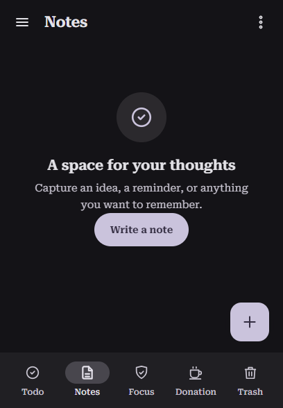
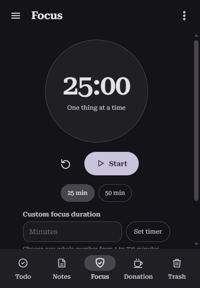

# TaskKar

TaskKar is a private, offline-first todo list, notebook, and focus timer. Install it as a Progressive Web App (PWA), or use the Android app. The interface adapts to phone and tablet screen sizes and supports both portrait and landscape layouts.

## Screenshots

| Todos | Notes | Focus |
| --- | --- | --- |
|  |  |  |

Swipe left or right across the main content to switch tabs; navigation buttons are also available. Todos include due dates and optional times. The focus timer supports custom sessions from 1 to 720 minutes.

## Run locally

You need Python 3 to run a local static web server. From the project folder:

```powershell
py -m http.server 8000
```

Open <http://localhost:8000>. Service workers require a secure context; `localhost` is supported. To install the PWA on a phone, host the project over HTTPS, open it in a supported browser, and choose **Add to Home Screen** or **Install app**. The static files can be hosted on any HTTPS web host.

## Offline use and your data

Todos and notes are stored locally in the browser's IndexedDB database; focus timer settings use local storage. The service worker caches the app shell for offline use. TaskKar has no account, analytics, cloud sync, or app backend. Your data stays on this device and is not included in the project files. Clearing browser or app data can delete it, so export or back up anything important before clearing storage.

The Android app bundles the PWA assets for offline use. Its optional **TaskKar Todo** home-screen widget shows active tasks after the app has been opened and refreshes as todo data changes.

## Android APK

The Android app supports Android 7.0 (API 24) and later. A debug-signed build is available in this workspace as `TaskKar-1.1.0-debug.apk`. It is intended for testing, not as an update to the previously released, production-signed APK. Android will reject it as an in-place update; uninstalling the existing app first may remove its locally stored data.

An installable release update must be signed with the original private release key. This machine does not have that key configured, so the 1.1.0 APK has not been published to [GitHub Releases](https://github.com/Kindujjwal/TaskKar/releases). Never publish or share the signing keystore or passwords.

To build from source, install JDK 17 and Android SDK Platform 35, then run in PowerShell:

```powershell
cd android-app
.\gradlew.bat assembleRelease
```

Release signing uses `TASKKAR_KEYSTORE`, `TASKKAR_KEYSTORE_PASSWORD`, `TASKKAR_KEY_ALIAS`, and `TASKKAR_KEY_PASSWORD` environment variables. Keep your signing keystore and passwords private and out of the repository. Future app updates must be signed with the same private key. Local SDK settings and signing files are excluded by `.gitignore`.

Roboto Serif is bundled under the SIL Open Font License; see [fonts/OFL-RobotoSerif.txt](fonts/OFL-RobotoSerif.txt).
